# MediMitra — HLD & LLD

> **MediMitra is a health portal where patients and their families keep every record, book doctors and lab tests, and follow progress over time with AI-assisted insights.**
>
> *Your family's health companion, wherever you are.*

**Author:** Prashant Singh · **Date:** 3 November 2026

## Table of contents

- [1. What MediMitra does](#1-what-medimitra-does)
- [2. Technical overview](#2-technical-overview)
- [3. Design principles and patterns](#3-design-principles-and-patterns)
- [4. High-Level Design](#4-high-level-design)
- [5. Multi-region architecture (India, EU, US)](#5-multi-region-architecture-india-eu-us)
- [6. Microservices catalogue](#6-microservices-catalogue)
- [7. Common module (`medimitra-common`)](#7-common-module-medimitra-common)
- [8. Authentication and tamper-proofing](#8-authentication-and-tamper-proofing)
- [9. Low-Level Design](#9-low-level-design)
- [10. Booking, payment and refund integrity](#10-booking-payment-and-refund-integrity)
- [11. UML class diagrams](#11-uml-class-diagrams)
- [12. Lifecycle diagrams](#12-lifecycle-diagrams)
- [13. AI agent design](#13-ai-agent-design)
- [14. Compliance and non-functional requirements](#14-compliance-and-non-functional-requirements)
- [15. Deployment, tech stack and rollout](#15-deployment-tech-stack-and-rollout)

## 1. What MediMitra does

MediMitra gives every patient one secure place for their entire health history, and lets the people who care for them, their doctors and their labs work from that same picture. It serves patients in India, Europe and the United States.

### The problem it solves

Today a patient's health story is scattered: prescriptions in a drawer, lab reports in email, notes with different doctors. Family members who live in another city or country rarely know how a parent's last check-up went. Doctors start each visit without the full history. Nobody sees the trend until something goes wrong.

### What each person gets

| Who | What they can do |
| --- | --- |
| Patients | Keep every visit, prescription and test result in one place; see how their health is changing over time; book doctors and lab tests; get reminders |
| Family members | With the patient's permission, follow a parent's or relative's health from anywhere, see every new result, and book appointments for them |
| Doctors | Publish their available times; see the patient's full history and latest results before the visit starts; record notes and prescriptions directly |
| Laboratories | Offer tests and collection slots, including home collection; send results straight into the patient's record |
| The provider (your organisation) | One platform across clinics, labs and countries; better follow-up and patient loyalty; a full record of who accessed what |

### A typical journey

1. Asha's father uploads his last three blood test reports from his phone. The portal reads the values automatically and asks him to confirm them.
2. Asha, who lives in another city, sees the same results on her phone and a chart of his blood sugar over the last six months.
3. The built-in assistant notices his sugar levels have been rising and suggests a follow-up with a diabetes specialist.
4. Asha asks the assistant to find a slot. It shows three options near her father's home; she picks one and pays. A booking can never be charged twice, and cancellations are refunded automatically according to the clinic's policy.
5. When her father arrives, the doctor already sees his history, recent results and a short summary. The doctor's notes and prescription appear in the record the same day.
6. Every six months, the family receives a progress report showing what has improved and what needs attention.

### The intelligent assistant

- Reads every new report and explains what has improved, what has worsened and what is due
- Suggests which kind of specialist to see when a result needs attention
- Books and reschedules doctor visits and lab tests on the user's behalf, always asking for confirmation first
- Produces charts and periodic progress reports
- Never diagnoses or prescribes; it always points the patient to a qualified doctor

### Trust and privacy

- The patient decides who sees their records, for how long, and can withdraw access at any time
- Data stays in the patient's own region (India, Europe or the US) and meets local health-privacy law in each
- Every view, change and payment is recorded and cannot be altered afterwards
- Payments use trusted local methods: UPI and cards in India, cards and bank payments in Europe and the US

### How it rolls out

1. Health records and family access
2. Doctor and lab booking with payments
3. The intelligent assistant and progress reports
4. Links with national health records, video consultations and wearables

## 2. Technical overview

MediMitra is a single portal where patients keep their full medical history, family caregivers follow it remotely, doctors and labs publish slots and results, and AI agents turn the records into trends, next steps and bookings. It is built as 15 Spring Boot services behind an API gateway, connected by Kafka events, with a separate AI agent layer.

**Problem.** Records are scattered across clinics, labs and paper. Family members who live away (for example, adult children of elderly parents) cannot see test results, follow progress or help book the next visit.

### Actors

| Actor | What they do in the portal |
| --- | --- |
| Patient | Owns the health record; uploads prescriptions and reports; books doctors and labs; chats with the AI assistant |
| Caregiver (family) | Views a linked patient's records, trends and AI reports with the patient's consent; can book on their behalf if allowed |
| Doctor | Publishes availability; sees a pre-visit summary and full history of booked patients; adds visit notes and e-prescriptions |
| Lab staff | Publishes tests and slots; manages sample collection; uploads results that flow straight into the patient record |
| Admin | Onboards and verifies doctors and labs; manages catalogues, policies and audits |
| AI agents | Background analysis agent (trends, alerts, progress reports) and conversational assistant (Q&A, booking on the user's behalf) |

### Goals

- One longitudinal record per patient: visits, doctor notes, prescriptions, lab results
- Structured data extracted from uploaded documents, so values can be charted over time
- AI insights: what improved, what worsened, which specialist to see next, with clear non-diagnostic wording
- End-to-end booking for doctor appointments and lab tests, including home sample collection
- Automatic hand-off: a doctor sees the patient's history and latest results when the visit starts
- Consent-based sharing with caregivers, doctors and labs, fully audited

### Scope

| In scope (v1) | Later phases |
| --- | --- |
| Web and mobile apps for patients, caregivers, doctors, labs | Insurance and claims |
| Manual upload + OCR extraction | ABDM / ABHA record linking (national health records exchange) |
| Doctor and lab scheduling, payments, notifications | Video teleconsultation |
| AI trend analysis, progress reports, assistant with booking | Wearables and device data |
| Caregiver access with consent | Pharmacy ordering |

## 3. Design principles and patterns

Every service follows hexagonal (ports and adapters) architecture with SOLID and the Law of Demeter enforced in code review and by ArchUnit tests in CI. Design patterns are applied only where they remove a real coupling or risk; each GoF pattern below names where it is used, or why it is deliberately not used.

### 3.1 Architectural principles

| Principle | How it is applied |
| --- | --- |
| Hexagonal architecture | `domain` has no Spring, JPA or Kafka imports; `application` depends on ports (interfaces); `infrastructure` implements them. ArchUnit rules fail the build on violations |
| Domain-driven design | Each service is one bounded context with its own ubiquitous language and aggregates (Appointment, Payment, Consent, Observation) |
| Database per service | No service reads another's tables; cross-service data only through APIs or events |
| Event-driven integration | Transactional outbox + idempotent consumers; no dual writes |
| Zero trust | Every service re-validates the JWT and calls Consent & Access; the gateway is not the only line of defence |
| Immutability | DTOs, events and value objects are Java records; `Money` uses minor units (`long`) + ISO currency, never `double` |
| Fail fast | Bean Validation on every inbound DTO; domain invariants checked in aggregate methods |
| Determinism | `Clock` and `IdGenerator` injected, so time- and id-dependent logic is testable |
| 12-factor | Config from environment / config server, stateless containers, logs as event streams |
| KISS / YAGNI | No pattern or service without a current requirement; e.g. no event sourcing outside the payment ledger |
| DRY, carefully | Shared contracts live in the common module; domain entities are never shared, to avoid a distributed monolith |

### 3.2 SOLID

| Principle | Concrete example in this design |
| --- | --- |
| **S**ingle responsibility | `BookingService` only holds and confirms slots; pricing is `PricingService`; messaging is the Notification service; refunds are `RefundService` |
| **O**pen/closed | Adding a payment provider (e.g. PayPal for the US) = one new adapter class + config entry; `PaymentService` is untouched |
| **L**iskov substitution | Every `PaymentProcessor` honours the same contract (idempotency key, amount in minor units, async confirmation). A shared abstract contract test suite runs against every adapter |
| **I**nterface segregation | Provider capabilities are split: `PaymentProcessor`, `RefundProcessor`, `WebhookVerifier`, `PaymentStatusQuery`. A provider that cannot do partial refunds does not implement a fake method |
| **D**ependency inversion | `BookingService` depends on `SlotRepository` and `PaymentPort` interfaces; JPA and Feign adapters are injected |

### 3.3 Law of Demeter (least knowledge)

- **Tell, don't ask.** `appointment.checkIn(clock)` instead of `appointment.setStatus(...)`; aggregates guard their own transitions.
- **No train wrecks.** Code like `appointment.getSlot().getDoctor().getClinic().getAddress()` is not allowed; APIs return flattened DTOs built for the caller (`AppointmentSummaryDto.clinicAddress`).
- **Talk only to direct collaborators.** A service calls only its own ports. Scheduling never calls Payment's database or Notification directly; it emits events or goes through the saga orchestrator.
- **AI agents know only tools.** The assistant sees tool contracts, never service internals, URLs or databases.
- **Enforced** by ArchUnit rules (layer access, no cross-aggregate getter chains in `application`) and Sonar rules.

### 3.4 GoF pattern map (all 23)

| Pattern | Type | Where it is used | Why |
| --- | --- | --- | --- |
| Factory Method | Creational | `PaymentProcessorFactory.forContext(region, method)`, `NotificationChannelFactory` | Callers ask for a capability, not a concrete provider |
| Abstract Factory | Creational | `RegionalComplianceFactory` → India / EU / US families: `PaymentProcessor`, `TaxCalculator`, `ConsentPolicy`, `DataRetentionPolicy` | Region-specific objects must always be used together |
| Builder | Creational | `EventEnvelope.builder()`, `PaymentIntentRequest.builder()`, `PromptBuilder`, `ProgressReport.builder()` | Many optional fields; immutable result; readable construction |
| Prototype | Creational | `AvailabilityTemplate.copyForWeek(date)` clones a doctor's weekly schedule | New weeks start from a proven template |
| Singleton | Creational | Spring-managed singleton beans only (stateless services, `JwksKeyCache`) | No hand-written static singletons: they break testing and DI |
| Adapter | Structural | `RazorpayAdapter`, `StripeAdapter`, `AdyenAdapter`, `TextractAdapter`, `DocumentAiAdapter`, `LlmProviderAdapter` | Wrap vendor SDKs behind our ports |
| Bridge | Structural | Notification `Message` types (Reminder, ResultReady, PaymentReceipt) × `Channel` implementations (SMS, Email, WhatsApp, Push) | Avoids a class per message × channel combination |
| Composite | Structural | `LabTestItem` → single `LabTest` or `LabPanel` (e.g. lipid profile) of tests; `price()` computed recursively | Panels and tests treated uniformly in cart and pricing |
| Decorator | Structural | `ResilientPaymentProcessor` (circuit breaker + retry + metrics) wraps any `PaymentProcessor`; `AuditingRecordReader` | Cross-cutting behaviour without touching adapters |
| Facade | Structural | `BookingFacade` used by AI tools (search → slots → hold); `PreVisitSummaryFacade` for doctors | One simple entry for multi-step flows |
| Flyweight | Structural | Shared immutable `TestDefinition` (LOINC code, unit, ranges) referenced by millions of `Observation`s from an in-memory cache | Memory and consistency for reference data |
| Proxy | Structural | Feign clients (remote proxy), `@PreAuthorize` consent checks (protection proxy), cached `ProviderDirectoryClient` (caching proxy) | Control access to a real object |
| Chain of Responsibility | Behavioural | Gateway filter chain (JWT → DPoP → rate limit → audit); AI guardrail chain (PII mask → injection check → output classifier → citation check); OCR validators | Ordered, pluggable checks |
| Command | Behavioural | Assistant actions as `BookAppointmentCommand`, `CancelBookingCommand` with `requiresConfirmation()` and compensations | Queue, confirm, audit and undo agent actions |
| Interpreter | Behavioural | **Not used.** Specialist-suggestion rules are a versioned data table, not a DSL | A rule language would add risk with no current need |
| Iterator | Behavioural | Keyset-paginated `ObservationCursor` for trend computation and GDPR exports | Process large histories without loading them in memory |
| Mediator | Behavioural | `BookingSagaOrchestrator` coordinates Scheduling, Payment, Notification | Services stay unaware of each other |
| Memento | Behavioural | `RecordVersion` snapshots: every correction to an observation or note stores the prior immutable version | Tamper evidence and restore without overwriting history |
| Observer | Behavioural | Kafka domain events; in-process `@TransactionalEventListener` writes the outbox | Loose coupling between producers and consumers |
| State | Behavioural | `AppointmentState`, `PaymentState`, `RefundState`, `LabOrderState` objects define allowed transitions | Illegal transitions are impossible, not just unlikely |
| Strategy | Behavioural | `PaymentProcessor` per provider, `RefundPolicy` (full / tiered / none), `TrendStrategy` per test type, `SlotGenerationStrategy`, `TaxCalculator` | Swap behaviour by region, provider or policy |
| Template Method | Behavioural | `AbstractIdempotentConsumer` (dedupe → validate → handle → record) in the common module; `AbstractReportExtractor` | Fixed algorithm skeleton, variable steps |
| Visitor | Behavioural | `RecordItemVisitor` over Encounter, Observation, Prescription: `PdfReportVisitor`, `FhirExportVisitor`, `DataExportVisitor` | New export formats without changing record classes |

### 3.5 Distributed-system patterns

| Pattern | Where |
| --- | --- |
| API Gateway + Backend for Frontend | Gateway for all clients; thin BFFs for patient app and doctor portal if payloads diverge |
| Saga (orchestrated) | Booking → payment → confirm → notify; refunds |
| Transactional outbox + idempotent consumer | Every service that publishes or consumes events |
| CQRS (read model) | Patient timeline view in Medical Records, built from events for fast reads |
| Event sourcing | Payment ledger only (append-only double-entry entries) |
| Circuit breaker, bulkhead, retry with jitter, timeout | All outbound calls via Resilience4j |
| Cell-based architecture | One independent cell per region (section 5) |

## 4. High-Level Design

All clients reach the platform through one API gateway. Domain services own their data and share changes only through REST APIs and Kafka events; the AI layer sits on top and reaches data only through those same APIs.

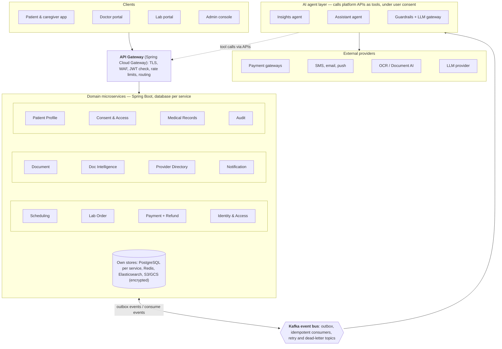

The main path is simple: clients call the gateway, the gateway routes to a service, the service commits and emits an event, and downstream services (records, notifications, AI) react. The AI agents call service APIs as tools (dashed arrow), so every AI read or booking passes the same consent and audit checks as a human user.

### Architectural decisions

| Decision | Choice | Why |
| --- | --- | --- |
| Service style | Microservices with database per service | Independent scaling of booking vs records vs AI; team ownership |
| Sync communication | REST (OpenAPI) through the gateway; Feign/WebClient between services with Resilience4j | Simple, well supported in Spring |
| Async communication | Kafka with transactional outbox | Reliable events for records, notifications and AI triggers |
| Distributed transactions | Sagas (booking → payment → confirm) | No 2PC across services |
| Health data model | FHIR-aligned resources (Patient, Encounter, Observation, MedicationRequest, DiagnosticReport) | Interoperability with hospitals, labs and ABDM later |
| Access control | RBAC + consent-based policy checks in Consent & Access | Caregiver and doctor access must be patient-controlled |
| AI integration | Agents as API clients, not database readers | Same security, audit and consent as any user |

## 5. Multi-region architecture (India, EU, US)

The platform runs as three independent regional cells, each a full copy of the stack in section 4, so patient data never leaves its home region. A thin global layer only routes users to their cell and holds no health data.

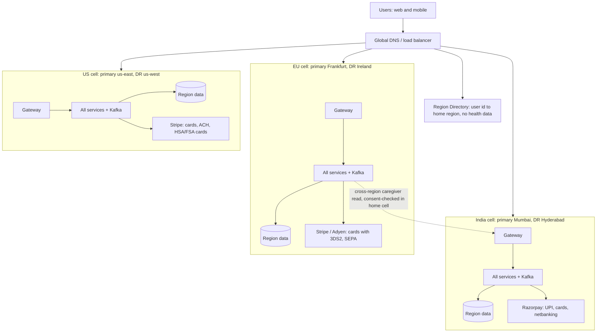

### 5.1 How region is decided and enforced

1. A patient's **home region** is set at sign-up from country of residence and stored in the Region Directory.
2. The access token carries a signed `region` claim (section 8). The global layer routes each request to that region's gateway.
3. Every service rejects a request whose `region` claim does not match its own cell. This check is in the common security module, so it cannot be skipped.
4. Moving a patient between regions is an explicit, audited migration job, never a side effect.

### 5.2 Cross-region family access

A caregiver in Germany following a parent in India authenticates in the EU cell. Their request for the parent's data is forwarded to the India cell, where consent is checked and audited. Data is shown to the caregiver but not stored in the EU cell. Legal sign-off on this cross-border view is listed as an open question.

### 5.3 Regional rules, isolated behind the Abstract Factory

`RegionalComplianceFactory` returns the matching family of objects for each cell (section 3.4).

| Concern | India | European Union | United States |
| --- | --- | --- | --- |
| Privacy law | DPDP Act 2023; ABDM health-data guidelines | GDPR (health = special category data), DPIA, Data Protection Officer | HIPAA (Business Associate Agreements, minimum necessary rule), state health-privacy laws |
| Consent model | Notice + consent, consent manager compatible | Explicit consent per purpose, withdrawable, portability and erasure rights | Authorisation for disclosures beyond treatment, payment and operations |
| Payment provider (Strategy) | Razorpay (fallback: PayU) | Stripe or Adyen | Stripe (fallback: Braintree) |
| Payment methods | UPI, cards, netbanking, wallets | Cards with Strong Customer Authentication (3DS2), SEPA debit, local methods | Cards, ACH, Apple Pay / Google Pay, HSA/FSA cards |
| Card data | Never stored; network tokenisation per RBI rules | Never stored; PCI DSS via provider | Never stored; PCI DSS via provider |
| Currency | INR | EUR (plus local where needed) | USD |
| Tax (`TaxCalculator`) | GST rules per service type | VAT rules per country | Sales tax rules per state |
| AI and OCR providers | In-region endpoints, no data retention | In-region endpoints, GDPR terms | HIPAA-eligible endpoints under a BAA |
| Languages | English, Hindi, regional languages | English, German, French, Spanish, others | English, Spanish |

Tax rates and healthcare exemptions vary by service and change over time, so they are configuration owned by the client's finance team, not code.

### 5.4 Global conventions

- Times stored in UTC, shown in the user's time zone; slots stored with the clinic's zone.
- Money as `Money(amountMinor: long, currency: ISO-4217)`; no currency conversion inside a booking.
- Phone numbers in E.164; addresses per country format; all text through i18n bundles.

## 6. Microservices catalogue

The platform has 15 services grouped into five domains. Each owns its database (database-per-service) and publishes domain events to Kafka through the transactional outbox pattern, so a DB commit and its event never diverge. Each service is built and deployed as `medimitra-<name>-service` (naming rules in section 7.5).

| # | Service | Responsibility | Data store | Key APIs | Events published |
| --- | --- | --- | --- | --- | --- |
| 1 | API Gateway | Single entry point; JWT validation, routing, rate limiting, request tracing | Redis (rate limits) | Routes `/api/**` | none |
| 2 | Identity & Access | Sign-up, login, OTP, MFA, roles (PATIENT, CAREGIVER, DOCTOR, LAB_STAFF, ADMIN), token issue | Keycloak + PostgreSQL | `/auth/login`, `/auth/otp`, `/users/me` | `user.registered` |
| 3 | Patient Profile | Demographics, emergency contacts, allergies list, family links | PostgreSQL | `/patients/{id}`, `/patients/{id}/family` | `patient.created`, `patient.updated` |
| 4 | Consent & Access | Who can see or act on whose data, for what purpose and how long; policy decision point for other services | PostgreSQL | `/consents`, `/consents/{id}/revoke`, `/access/check` | `consent.granted`, `consent.revoked` |
| 5 | Medical Records | Encounters (visits), doctor notes, prescriptions, diagnoses, lab observations; FHIR-aligned model | PostgreSQL (+ JSONB) | `/records/{patientId}/encounters`, `/observations`, `/prescriptions`, `/timeline` | `record.created`, `observation.recorded` |
| 6 | Document | Upload, virus scan, encryption, storage, presigned download URLs | Object storage (S3/GCS) + PostgreSQL metadata | `/documents` (multipart), `/documents/{id}/url` | `document.uploaded` |
| 7 | Document Intelligence | OCR and LLM extraction of test names, values, units, reference ranges, medicines; confidence scores; human confirm step | PostgreSQL | `/extractions/{docId}`, `/extractions/{id}/confirm` | `extraction.completed`, `extraction.confirmed` |
| 8 | Provider Directory | Doctors, specialties, clinics, labs, lab test catalogue, prices, verification status, search | PostgreSQL + Elasticsearch | `/doctors?specialty=&city=`, `/labs`, `/lab-tests` | `provider.verified` |
| 9 | Scheduling | Doctor availability templates, slot generation, slot holds, appointment booking, reschedule, cancel, check-in | PostgreSQL + Redis (slot locks) | `/doctors/{id}/slots`, `/appointments`, `/appointments/{id}/check-in` | `appointment.booked`, `appointment.checked_in`, `appointment.completed`, `appointment.cancelled` |
| 10 | Lab Order | Lab test booking, home or walk-in collection, sample tracking, result publishing | PostgreSQL | `/lab-orders`, `/lab-orders/{id}/sample`, `/lab-orders/{id}/results` | `lab_order.booked`, `lab_result.published` |
| 11 | Payment | Region-aware payment strategies (Razorpay/UPI, Stripe, Adyen), idempotent payment intents, refund engine, ledger, reconciliation (section 10) | PostgreSQL | `/payments`, `/payments/{id}/refund`, webhook | `payment.succeeded`, `payment.failed` |
| 12 | Notification | Email, SMS, WhatsApp, push; templates; user preferences; reminders | PostgreSQL + Redis | internal only | none (consumer) |
| 13 | AI Insights | Background analysis agent: trends, abnormal flags, specialist suggestions, periodic progress reports and charts | PostgreSQL + vector store (pgvector) | `/insights/{patientId}`, `/reports/{patientId}?period=6m` | `insight.generated`, `alert.raised` |
| 14 | AI Assistant | Conversational agent for patients, caregivers and doctors; calls platform APIs as tools on the user's behalf | PostgreSQL (conversations) + Redis | `/assistant/chat` (SSE streaming) | `assistant.action_taken` |
| 15 | Audit | Immutable log of every read, write, share and AI action on health data | Append-only store (e.g. ClickHouse or BigQuery) | `/audit?patientId=` (admin, patient) | none (consumer) |

### Kafka topics and consumers

| Topic | Producer | Consumers | Purpose |
| --- | --- | --- | --- |
| `document.uploaded` | Document | Document Intelligence | Start OCR and extraction |
| `extraction.confirmed` | Document Intelligence | Medical Records | Write structured observations and prescriptions |
| `observation.recorded` | Medical Records | AI Insights | Re-run trend analysis for that patient |
| `lab_result.published` | Lab Order | Medical Records, Notification | Results land in the record; patient and caregivers notified |
| `appointment.booked` | Scheduling | Notification, AI Insights | Confirmations; build pre-visit summary for the doctor |
| `appointment.checked_in` | Scheduling | Consent & Access | Grant the doctor time-boxed access to the patient record |
| `consent.granted` / `consent.revoked` | Consent & Access | Gateway cache, AI Assistant | Refresh access decisions |
| `insight.generated` / `alert.raised` | AI Insights | Notification | Notify patient and caregivers |
| `payment.succeeded` | Payment | Scheduling, Lab Order | Confirm the held slot |
| `*.*` (all domain events) | All | Audit | Audit trail |

Every consumer is idempotent (event id dedupe table). Failed messages go to retry topics with backoff, then a dead-letter topic with alerting.

## 7. Common module (`medimitra-common`)

Shared code is a set of small, versioned Spring Boot starters under the Maven group `com.medimitra`, not one large jar. It holds contracts and cross-cutting plumbing only: Kafka templates, event and error DTOs, the exception hierarchy, security and idempotency. Domain entities and business logic are never shared, so services can evolve and deploy independently.

### 7.1 Modules

| Module | Contents | Used by |
| --- | --- | --- |
| `medimitra-bom` | Dependency versions (Spring Boot, Kafka, Resilience4j, Testcontainers) | All |
| `medimitra-common-core` | `Money`, `Region`, typed ids (`PatientId`, `SlotId`), `ClockProvider`, `IdGenerator`, `ErrorCode` enum, exception hierarchy | All |
| `medimitra-common-contracts` | Versioned event payloads generated from Avro schemas (`AppointmentBookedV1`, `PaymentSucceededV1`...), cross-service API DTOs, `PageResponse<T>`, `ApiError` (RFC 9457 problem details) | All |
| `medimitra-common-messaging` | `EventEnvelope<T>`, `EventPublisher` port, `KafkaEventPublisher` (wraps `KafkaTemplate`), outbox entity + relay, `AbstractIdempotentConsumer`, `ProcessedEvent` dedupe store, topic names, retry and dead-letter configuration | Every producer and consumer |
| `medimitra-common-security` | `JwtTokenValidator`, `JwtAuthenticationFilter`, `DpopProofVerifier`, `RegionGuard`, `AuthenticatedPrincipal`, `ServiceTokenProvider`, `@RequiresConsent` + `ConsentClient` | All services and the gateway |
| `medimitra-common-web` | `GlobalExceptionHandler`, `@Idempotent` + `IdempotencyInterceptor` + `IdempotencyStore`, correlation-id filter, PII-masking request logger | All REST services |
| `medimitra-common-observability` | OpenTelemetry setup, MDC propagation, PII-masking log layout | All |
| `medimitra-common-test` | Testcontainers base classes (PostgreSQL, Kafka, Redis), `PaymentProcessorContractTest`, JWT test token factory | Test scope only |

### 7.2 Governance rules

- **Semantic versioning;** a breaking contract change means a new event version (`V2`), published alongside `V1` until all consumers move.
- **Schema Registry** set to backward compatibility; CI fails on an incompatible Avro change.
- **Auto-configuration is opt-in** through `@EnableMediMitraMessaging`, `@EnableMediMitraSecurity`; no hidden beans.
- **No business rules** in common modules; a reviewer from the platform team approves every change.

### 7.3 Exception hierarchy

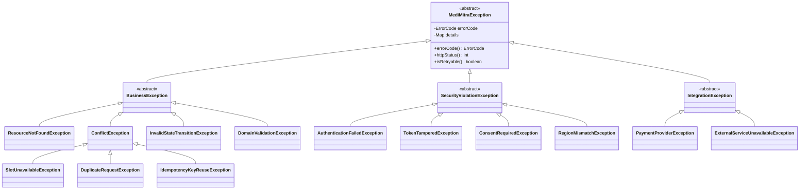

`GlobalExceptionHandler` maps each exception to an `ApiError` with a stable code (e.g. `MM-SCH-409-SLOT_TAKEN`) and the correlation id. Security exceptions return generic messages to the client and full detail only to logs and the audit trail.

### 7.4 Key classes (sketch)

```java
// medimitra-common-messaging: immutable envelope for every event (Builder)
@Builder(toBuilder = true)
public record EventEnvelope<T>(
        UUID eventId, String eventType, int schemaVersion,
        String aggregateType, String aggregateId,
        Region region, String correlationId, String causationId,
        Instant occurredAt, String producer, T payload) { }

// Port: services depend on this, not on KafkaTemplate (DIP)
public interface EventPublisher {
    void publish(EventEnvelope<?> event); // writes to the outbox in the caller's transaction
}

// Template Method: every consumer gets dedupe, validation and recording for free
public abstract class AbstractIdempotentConsumer<T> {
    private final ProcessedEventRepository processed;

    @Transactional
    public final void consume(EventEnvelope<T> event) {
        if (processed.existsById(event.eventId())) return;   // duplicate delivery
        validate(event);
        handle(event);                                       // business step
        processed.save(ProcessedEvent.of(event.eventId(), consumerName()));
    }
    protected void validate(EventEnvelope<T> event) { }
    protected abstract void handle(EventEnvelope<T> event);
    protected abstract String consumerName();
}
```

The outbox relay publishes with `KafkaTemplate` configured for idempotent, transactional producers (`enable.idempotence=true`, `acks=all`), keyed by `aggregateId` so events for one booking stay in order.

### 7.5 MediMitra naming conventions

Every technical name derives from the single prefix `medimitra`, so the platform stays consistent and can be rebranded by changing that prefix in one place.

| Item | Convention | Example |
| --- | --- | --- |
| Maven group / root package | `com.medimitra` | `com.medimitra.scheduling` |
| Parent and BOM | `medimitra-parent`, `medimitra-bom` | `<artifactId>medimitra-bom</artifactId>` |
| Shared starters | `medimitra-common-<area>` | `medimitra-common-messaging` |
| Services | `medimitra-<name>-service` | `medimitra-scheduling-service`, `medimitra-payment-service` |
| Gateway | `medimitra-api-gateway` | `api.medimitra.<domain>` |
| Container images | `<registry>/medimitra/<service>:<version>` | `registry/medimitra/scheduling-service:1.4.0` |
| Kubernetes namespace | `medimitra-<env>` | `medimitra-prod` |
| Keycloak realm (per region) | `medimitra-<region>` | `medimitra-in`, `medimitra-eu`, `medimitra-us` |
| JWT issuer / audience | `https://auth.<region>.medimitra.<domain>` / `medimitra-<service>` | `aud: medimitra-scheduling` |
| Kafka topics | `medimitra.<region>.<aggregate>.<event>.v<n>` | `medimitra.in.appointment.booked.v1` |
| Consumer groups | `medimitra-<service>-<purpose>` | `medimitra-notification-appointment` |
| Databases / schemas | `medimitra_<service>` | `medimitra_payment` |
| Config properties | `medimitra.<area>.*` | `medimitra.payment.hold-ttl=10m` |
| Auto-configuration annotations | `@EnableMediMitra<Area>` | `@EnableMediMitraMessaging` |
| Base exception | `MediMitraException` | `SlotUnavailableException extends ConflictException` |
| Error codes | `MM-<SERVICE>-<HTTP>-<REASON>` | `MM-SCH-409-SLOT_TAKEN` |
| Metrics prefix | `medimitra_` | `medimitra_booking_confirmed_total` |
| HTTP headers | `X-MediMitra-*` for platform headers | `X-MediMitra-Correlation-Id` |

Short topic names used elsewhere in this document (e.g. `appointment.booked`) map to the full form above.

## 8. Authentication and tamper-proofing

Authentication uses short-lived, asymmetrically signed JWT access tokens bound to the client, with rotating refresh tokens. Every service re-validates the token. Beyond login, every record, document, event, payment and audit entry carries integrity protection so that any tampering is either impossible or detectable.

### 8.1 Token design

| Item | Decision |
| --- | --- |
| Issuer | Keycloak, one realm per regional cell (`medimitra-in`, `medimitra-eu`, `medimitra-us`) |
| Format | JWS access token, `typ: at+jwt` (RFC 9068) |
| Signing | ES256 (or RS256) with private keys in KMS/HSM; **never** HS256 shared secrets |
| Access token lifetime | 5 minutes for all users |
| Refresh token | Opaque, 24 hours idle / 30 days max (patients), 8 hours (staff); rotated on every use |
| Sender constraint | DPoP proof (RFC 9449) for mobile and web; `cnf.jkt` claim binds the token to the client key, so a stolen token is useless elsewhere |
| Claims | `sub`, `iss`, `aud`, `exp`, `nbf`, `iat`, `jti`, `roles`, `scope`, `region`, `acr`, `cnf`, `sid`; **no** names, phone numbers or health data |
| Key rotation | Every 90 days with overlapping `kid`s published in JWKS |

### 8.2 Login and request flow

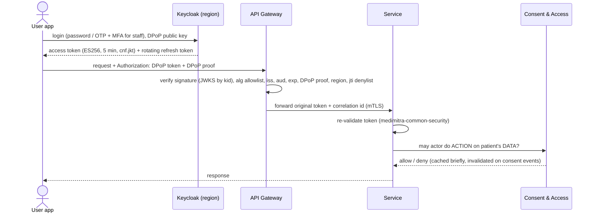

### 8.3 Validation rules (medimitra-common-security, used by gateway and every service)

1. Reject any `alg` not in the allowlist (`ES256`, `RS256`); this blocks `alg: none` and key-confusion attacks.
2. Select the key only by `kid` from the cached JWKS; on an unknown `kid`, refresh JWKS at most once a minute.
3. Exact match on `iss`; `aud` must contain this service; `typ` must be `at+jwt`.
4. `exp`, `nbf`, `iat` checked with at most 30 seconds clock skew.
5. DPoP proof verified: signature with the bound key, `htm` and `htu` match the request, `iat` fresh, `jti` not replayed.
6. `region` claim equals the cell's region (`RegionGuard`).
7. `jti` / `sid` checked against a Redis denylist for logged-out or compromised sessions.
8. Required `acr` level for sensitive actions; otherwise respond with a step-up challenge.
9. Tokens are never logged; the logger masks the `Authorization` header.

### 8.4 Refresh, logout and step-up

- **Rotation with reuse detection:** each refresh returns a new refresh token; presenting an old one revokes the whole token family and forces re-login.
- **Storage:** web uses a backend-for-frontend with `HttpOnly; Secure; SameSite=Strict` cookies, so tokens never reach JavaScript; mobile uses iOS Keychain / Android Keystore.
- **Logout** revokes the session in Keycloak and adds `sid` to the denylist until the access token's expiry.
- **Step-up authentication** (`acr` = MFA within 5 minutes) is required to pay, grant or revoke consent, export data or delete records. MFA is always required for doctors, lab staff and admins.

### 8.5 Service-to-service and AI agent identity

- All internal traffic uses **mTLS** through the service mesh; network policies allow only declared callers.
- Background jobs use **client-credentials tokens** with a narrow audience per target service.
- The AI assistant acts **on behalf of** the user through token exchange (RFC 8693): the exchanged token keeps the user as `sub` and adds `act: {sub: ai-assistant}`. Consent checks apply to the user; audit records show "AI assistant on behalf of user".

### 8.6 Integrity of data, events and money

| Asset | Protection | Tampering result |
| --- | --- | --- |
| Prices and amounts | Computed server-side from the slot or lab price snapshot; client-sent amounts ignored | Cannot change what is charged |
| Payment webhooks | Provider signature (HMAC with timestamp tolerance) verified; provider event id stored to block replays; provider IP allowlist | Forged or replayed callbacks rejected |
| Uploaded documents | SHA-256 stored at upload; checked on every download; originals in object-lock (WORM) storage | Changed file is detected and blocked |
| Lab results | Labs sign result payloads (JWS with the lab's registered key); verified on ingest | Unsigned or altered results rejected |
| Medical records | Append-only; a correction creates a new version (Memento) with author and reason; doctor notes carry a content hash and signer id | History cannot be silently rewritten |
| Audit log | Hash-chained entries (each includes the previous entry's hash); chain head anchored hourly to WORM storage | Any deletion or edit breaks the chain and raises an alert |
| Payment ledger | Append-only double-entry ledger, hash-chained; DB role has no `UPDATE` / `DELETE` grant | Balances cannot be altered after the fact |
| Kafka events | mTLS + per-topic ACLs (only Payment may write `payment.*`); consumers check the envelope `producer` against an allowlist | A service cannot fake another's events |
| Secrets and keys | KMS / Vault, short-lived database credentials, nothing in images or Git | Leaked image exposes no secrets |
| Software supply chain | Signed container images (cosign), SBOM, admission policy that admits only signed images | Unknown or modified images never run |
| Mobile apps | Certificate pinning, Play Integrity / App Attest checks on login | Repackaged apps and interception are blocked |

## 9. Low-Level Design

The LLD covers the core data model, the internal design of the Scheduling service (the most concurrency-sensitive service), key API contracts and the four main runtime sequences. Other services follow the same layered package structure.

### 9.1 Core data model

Each block lives in the database of the service named in section 6; cross-service references are ids only, never foreign keys across databases.

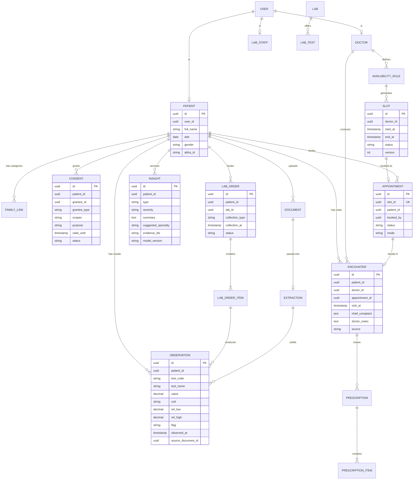

### 9.2 Service package structure (all services)

```
com.medimitra.scheduling
├── api            // REST controllers, request/response DTOs, OpenAPI
├── application    // use-case services, transactions, sagas
├── domain         // entities, value objects, domain events, policies
├── infrastructure
│   ├── persistence   // JPA repositories, outbox table
│   ├── messaging     // Kafka producers/consumers, outbox relay
│   └── client        // Feign/WebClient for other services
└── config         // security, Kafka, Resilience4j
```

### 9.3 Class design

Full UML class diagrams for every service and the common module are in section 11.

### 9.4 Key API contracts

| Method | Endpoint | Service | Called by |
| --- | --- | --- | --- |
| POST | `/api/v1/documents` (multipart: file, type, encounterDate) | Document | Patient, caregiver |
| POST | `/api/v1/extractions/{id}/confirm` | Document Intelligence | Patient |
| GET | `/api/v1/records/{patientId}/timeline?from=&to=` | Medical Records | Patient, caregiver, doctor |
| GET | `/api/v1/records/{patientId}/observations?testCode=HBA1C` | Medical Records | Patient, caregiver, doctor, AI |
| GET | `/api/v1/doctors?specialty=&city=&date=` | Provider Directory | Patient, AI |
| GET | `/api/v1/doctors/{id}/slots?from=&to=` | Scheduling | Patient, AI |
| POST | `/api/v1/appointments` | Scheduling | Patient, caregiver, AI (after confirm) |
| POST | `/api/v1/lab-orders` | Lab Order | Patient, caregiver, AI (after confirm) |
| POST | `/api/v1/lab-orders/{id}/results` | Lab Order | Lab staff |
| POST | `/api/v1/consents` | Consent & Access | Patient |
| GET | `/api/v1/insights/{patientId}` | AI Insights | Patient, caregiver, doctor |
| POST | `/api/v1/assistant/chat` (SSE) | AI Assistant | All users |

Example — book an appointment:

```json
POST /api/v1/appointments
Idempotency-Key: 7f1c2e8a-...
{
  "slotId": "b3e1...",
  "patientId": "9a7c...",
  "mode": "IN_PERSON",
  "reason": "Diabetes follow-up",
  "shareRecords": true
}

201 Created
{
  "appointmentId": "e42d...",
  "status": "PENDING_PAYMENT",
  "holdExpiresAt": "2026-11-10T10:05:00+05:30",
  "paymentIntentId": "pi_..."
}
```

### 9.5 Sequence — book a doctor appointment

The booking, payment and refund sequences, with their duplicate-payment safeguards, are in section 10.

### 9.6 Sequence — upload a report to AI insight

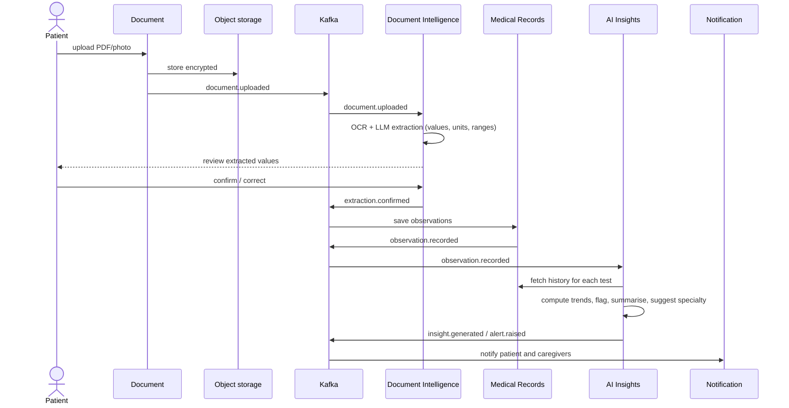

### 9.7 Sequence — visit check-in and doctor hand-off

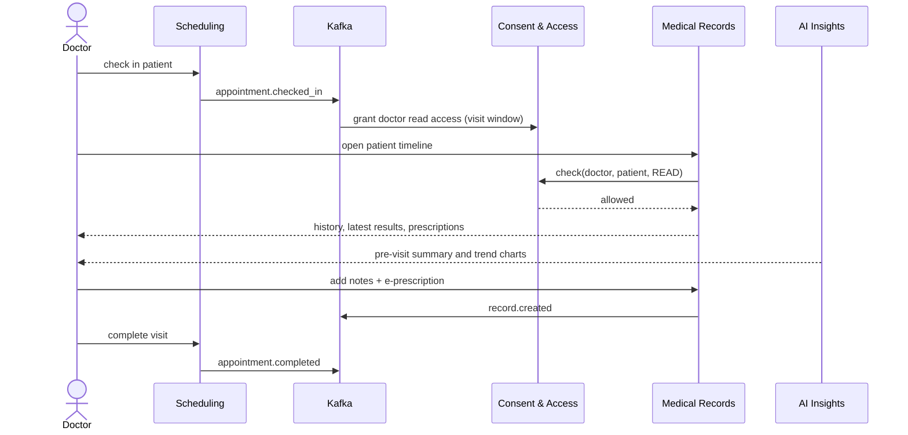

### 9.8 Sequence — lab booking to result

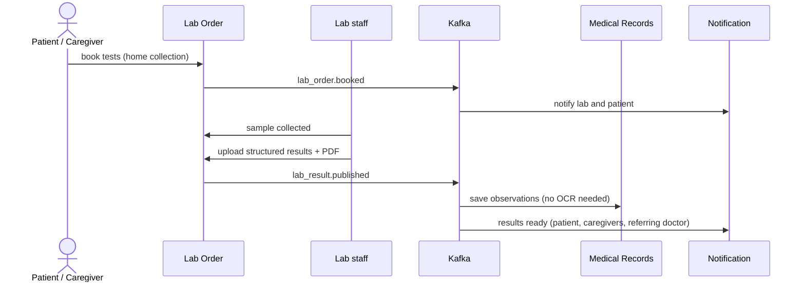

## 10. Booking, payment and refund integrity

A slot can be booked once, a booking can be charged once, and refunds can never exceed what was captured. These guarantees are enforced by database constraints, not just application code, so they hold under retries, crashes, duplicate webhooks and concurrent users.

### 10.1 Guarantees

| Invariant | Enforced by |
| --- | --- |
| One active appointment per slot | Conditional `UPDATE` on the slot row + partial unique index on `appointment(slot_id)` |
| One live payment per booking | Partial unique index on `payment(booking_id)` + provider idempotency key = `payment.id` |
| Same request never processed twice | `Idempotency-Key` header stored with a request hash; unique on `(principal_id, key)` |
| Same webhook never applied twice | Unique `(provider, provider_event_id)` in `processed_webhook` |
| Booking confirmed only by money actually received | Confirmation only from a signature-verified webhook or a server-side status query, never from the client redirect |
| Amount charged = server price | Price snapshot taken at hold time; client amounts ignored |
| Total refunds ≤ captured amount | `CHECK (refunded_minor <= captured_minor)` on `payment`, updated under a row lock in the same transaction as the refund record |
| Each refund issued once | Unique `(payment_id, reason_ref)` + provider idempotency key = `refund.id` |
| Every money movement is recorded | Append-only, hash-chained double-entry ledger |
| Nothing is left half-done | Persisted saga state; every step idempotent; reconciliation job closes gaps |

### 10.2 Payment strategy design

Providers are Strategies behind segregated interfaces, wrapped by a resilience Decorator, chosen by a Factory, with region families from the Abstract Factory (section 3.4).

```java
public interface PaymentProcessor {            // ISP: only what every provider can do
    PaymentIntentResult createIntent(PaymentIntentRequest request); // idempotent on request.idempotencyKey()
    ProviderPaymentStatus fetchStatus(ProviderPaymentRef ref);
    ProviderType provider();
}
public interface RefundProcessor {
    RefundResult refund(RefundRequest request);           // idempotent on request.idempotencyKey()
    ProviderRefundStatus fetchRefundStatus(ProviderRefundRef ref);
}
public interface WebhookVerifier {
    VerifiedWebhookEvent verify(String rawBody, Map<String, String> headers); // throws TokenTamperedException
}

// Adapters (Adapter + Strategy): RazorpayAdapter, StripeAdapter, AdyenAdapter implement all three

@Component
class PaymentProcessorFactory {                       // Factory Method
    private final Map<ProviderType, PaymentProcessor> processors;
    private final PaymentRoutingConfig routing;          // region + method -> provider, from config
    PaymentProcessor forContext(Region region, PaymentMethod method) {
        ProviderType type = routing.providerFor(region, method);
        return new ResilientPaymentProcessor(processors.get(type)); // Decorator: breaker, retry, metrics
    }
}
```

Adding a provider means one adapter, one routing entry and passing `PaymentProcessorContractTest`; no change to `PaymentService` (open/closed).

### 10.3 Defence layers against double booking and double charging

1. **Client:** the app generates one `Idempotency-Key` per checkout and reuses it on every retry; the Pay button disables after the first tap (convenience only, never relied on).
2. **Idempotency store:** first request with a key stores `request_hash` and status `IN_PROGRESS`; repeats with the same body return the stored response; the same key with a different body returns `422 IDEMPOTENCY_KEY_REUSE`.
3. **Atomic slot hold:** one SQL statement claims the slot; exactly one concurrent caller gets `1 row updated`, all others get `SlotUnavailableException`.
4. **Unique indexes** make a second active appointment or a second live payment for the same booking impossible, even if application code had a bug.
5. **Provider idempotency:** the provider call uses `payment.id` as its idempotency key, so a retried create returns the same payment intent rather than a new charge.
6. **Verified confirmation only:** the booking moves to `CONFIRMED` on a signed webhook or a server-side status fetch, inside one transaction with the outbox event.
7. **Webhook dedupe:** the provider event id is inserted first; a duplicate insert ends processing.
8. **Optimistic locking** (`@Version`) on `Appointment` and `Payment`; State objects reject illegal transitions.
9. **Reconciliation** every 15 minutes and against daily settlement files catches anything the above missed (e.g. a bank double debit) and auto-refunds the extra charge.

### 10.4 Database constraints

```sql
-- Scheduling
UPDATE slot
   SET status = 'HELD', hold_id = :holdId, held_until = :heldUntil, version = version + 1
 WHERE id = :slotId
   AND (status = 'OPEN' OR (status = 'HELD' AND held_until < now()));   -- 1 row = you own the slot

CREATE UNIQUE INDEX uq_active_appointment_per_slot ON appointment (slot_id)
  WHERE status IN ('PENDING_PAYMENT', 'CONFIRMED', 'CHECKED_IN', 'IN_CONSULTATION');

-- Payment
CREATE UNIQUE INDEX uq_live_payment_per_booking ON payment (booking_type, booking_id)
  WHERE status IN ('CREATED', 'PENDING', 'AUTHORIZED', 'CAPTURED', 'PARTIALLY_REFUNDED');
CREATE UNIQUE INDEX uq_provider_payment ON payment (provider, provider_payment_id);
ALTER TABLE payment ADD CONSTRAINT chk_refund_cap CHECK (refunded_minor <= captured_minor);

CREATE TABLE processed_webhook (
  provider TEXT, provider_event_id TEXT, received_at TIMESTAMPTZ NOT NULL,
  PRIMARY KEY (provider, provider_event_id));

CREATE TABLE refund (
  id UUID PRIMARY KEY, payment_id UUID NOT NULL REFERENCES payment(id),
  reason_ref TEXT NOT NULL, amount_minor BIGINT NOT NULL CHECK (amount_minor > 0),
  status TEXT NOT NULL, version INT NOT NULL,
  UNIQUE (payment_id, reason_ref));

-- Shared (medimitra-common-web)
CREATE TABLE idempotency_record (
  principal_id UUID, idem_key TEXT, request_hash TEXT NOT NULL, status TEXT NOT NULL,
  response_code INT, response_body JSONB, expires_at TIMESTAMPTZ NOT NULL,
  PRIMARY KEY (principal_id, idem_key));
```

### 10.5 Booking and payment saga

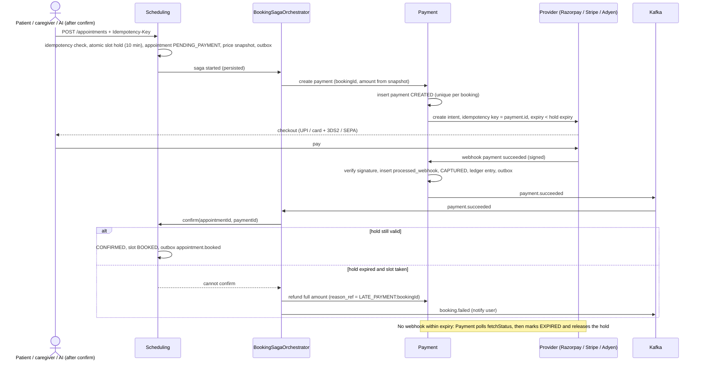

### 10.6 Failure scenarios

| Scenario | Outcome |
| --- | --- |
| User double-taps Pay or the app retries after a timeout | Same `Idempotency-Key` returns the original response; one booking, one intent |
| Two users pick the same slot at the same moment | Conditional update lets exactly one win; the other gets `409 SLOT_TAKEN` with alternatives |
| Provider sends the same webhook three times | First insert into `processed_webhook` wins; others are no-ops |
| Webhook never arrives | Status poller and reconciliation fetch the real status and continue the saga |
| Payment succeeds after the hold expired | Re-hold if the slot is still free, otherwise automatic full refund and notification |
| Bank or provider debits twice | Reconciliation finds two successful charges for one booking and refunds the extra automatically |
| Payment service crashes after capture, before publishing | Outbox row is in the same transaction; the relay publishes on restart |
| Orchestrator crashes mid-saga | Saga state is persisted; on restart it resumes the last incomplete, idempotent step |
| Kafka redelivers an event | `AbstractIdempotentConsumer` skips already-processed event ids |
| Client tampers with the amount | Ignored; the charge uses the server price snapshot |
| Provider outage | Circuit breaker opens; user offered another method or provider for that region; hold kept until expiry |

### 10.7 Refund design

**Policy (Strategy):** `RefundPolicyResolver` picks a `RefundPolicy` by reason; each returns an amount and is configurable per clinic or lab.

| Reason | Policy | Typical result (configurable) |
| --- | --- | --- |
| Doctor or lab cancels | `ProviderCancelledPolicy` | 100% automatically |
| Patient cancels | `TieredCancellationPolicy` | Full, partial or none by time before the visit, per clinic rules |
| No-show | `NoShowPolicy` | Usually none; clinic configurable |
| Lab sample rejected | `SampleRejectedPolicy` | Free re-collection or 100% |
| Late payment / duplicate charge | `SystemErrorPolicy` | 100% of the affected charge, automatically |

**Execution rules**

- Refunds always go back to the **original payment method** through the same provider.
- Creating a refund locks the payment row (`SELECT ... FOR UPDATE`), checks the remaining refundable amount, inserts the refund and increments `refunded_minor` in one transaction; the `CHECK` constraint is the final guard.
- The provider call uses `refund.id` as idempotency key, so retries never create a second refund.
- Retries use exponential backoff with jitter (e.g. 1 min, 5 min, 30 min, 2 h, 6 h); after the last attempt the refund moves to `MANUAL_REVIEW` with an operations alert.
- Final status comes from the provider's refund webhook or a status poll; the patient is notified at request, success and any delay.
- Every refund writes ledger entries; reconciliation matches them against provider settlement reports.

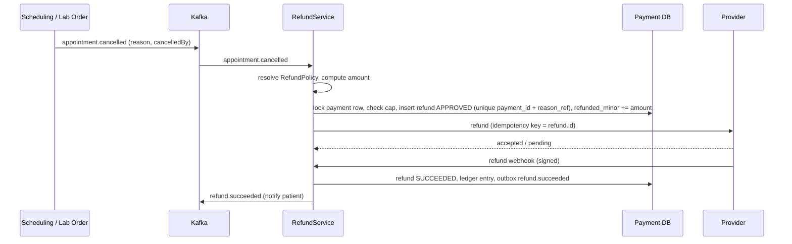

### 10.8 Payment and refund state machines

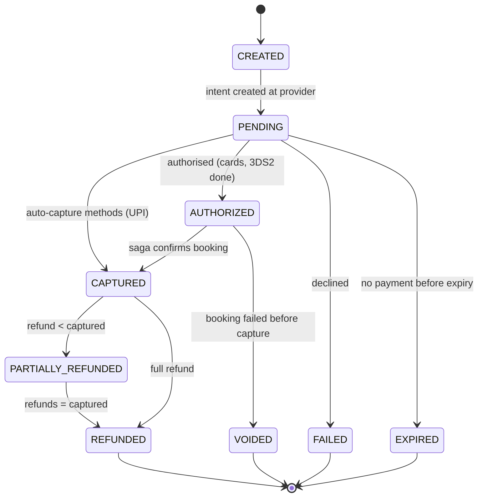

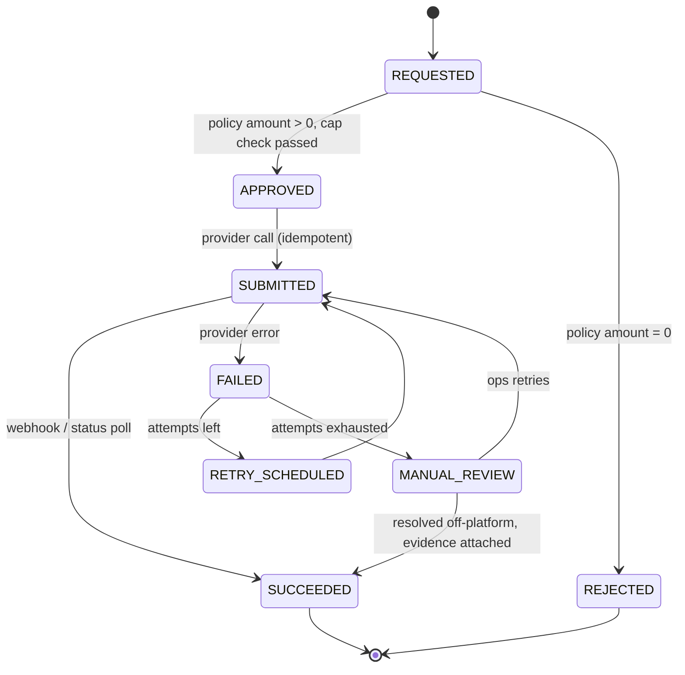

### 10.9 Ledger and reconciliation

- Every capture, refund, platform fee and provider payout is a pair of balanced ledger entries; balances are derived, never edited.
- **Every 15 minutes:** payments or refunds stuck in a pending state beyond their threshold are re-queried at the provider.
- **Daily:** provider settlement files are matched line by line against the ledger; known mismatch types are fixed automatically, others go to a finance operations queue with an SLA.
- Dashboards and alerts: unmatched transactions, refunds in `MANUAL_REVIEW`, duplicate-charge detections, webhook failure rate.

## 11. UML class diagrams

Each diagram shows one service's classes by hexagonal layer: controllers (`api`), use-case services (`application`), aggregates and value objects (`domain`), and ports with their adapters (`infrastructure`). Interfaces marked `<<port>>` are what the application layer depends on; adapters implement them. DTO mappers, JPA entities mirroring aggregates, and configuration classes are omitted for readability.

### 11.1 Common module: messaging and security

```mermaid
classDiagram
    class EventEnvelope~T~ {
        <<record>>
        UUID eventId
        String eventType
        int schemaVersion
        String aggregateId
        Region region
        String correlationId
        String producer
        Instant occurredAt
        T payload
        +builder() EventEnvelopeBuilder
    }
    class EventPublisher {
        <<port>>
        +publish(EventEnvelope) void
    }
    class OutboxEventPublisher {
        -OutboxRepository repo
        +publish(EventEnvelope) void
    }
    class OutboxRelay {
        -KafkaTemplate kafkaTemplate
        -OutboxRepository repo
        +relayBatch() void
    }
    class OutboxRecord {
        UUID id
        String topic
        String key
        byte[] payload
        OutboxStatus status
        int attempts
    }
    class AbstractIdempotentConsumer~T~ {
        <<abstract>>
        -ProcessedEventRepository processed
        +consume(EventEnvelope) void
        #validate(EventEnvelope) void
        #handle(EventEnvelope)* void
        #consumerName()* String
    }
    class KafkaTopicsConfig {
        +retryTopics() RetryTopicConfiguration
        +deadLetterPublisher() DeadLetterPublishingRecoverer
    }
    class JwtTokenValidator {
        -JwksKeyCache keys
        -Set allowedAlgs
        +validate(String token) VerifiedToken
    }
    class JwksKeyCache {
        +keyFor(String kid) PublicKey
        +refreshIfUnknown(String kid) void
    }
    class DpopProofVerifier {
        +verify(String proof, HttpRequest req, String jkt) void
    }
    class RegionGuard {
        -Region cellRegion
        +check(VerifiedToken) void
    }
    class JwtAuthenticationFilter {
        +doFilterInternal(req, res, chain) void
    }
    class AuthenticatedPrincipal {
        <<record>>
        UUID userId
        Set roles
        Region region
        String actingAgent
    }
    class ConsentClient {
        <<port>>
        +isAllowed(UUID actor, UUID patient, Action, DataScope) boolean
    }
    class IdempotencyInterceptor {
        -IdempotencyStore store
        +preHandle(req, res, handler) boolean
    }
    class IdempotencyStore {
        <<port>>
        +begin(UUID principal, String key, String hash) IdempotencyRecord
        +complete(IdempotencyRecord, int code, String body) void
    }
    class GlobalExceptionHandler {
        +handle(MediMitraException) ResponseEntity~ApiError~
    }
    EventPublisher <|.. OutboxEventPublisher
    OutboxEventPublisher --> OutboxRecord
    OutboxRelay --> OutboxRecord
    OutboxEventPublisher ..> EventEnvelope
    AbstractIdempotentConsumer ..> EventEnvelope
    JwtAuthenticationFilter --> JwtTokenValidator
    JwtAuthenticationFilter --> DpopProofVerifier
    JwtAuthenticationFilter --> RegionGuard
    JwtTokenValidator --> JwksKeyCache
    JwtAuthenticationFilter ..> AuthenticatedPrincipal
    IdempotencyInterceptor --> IdempotencyStore
```

### 11.2 API Gateway

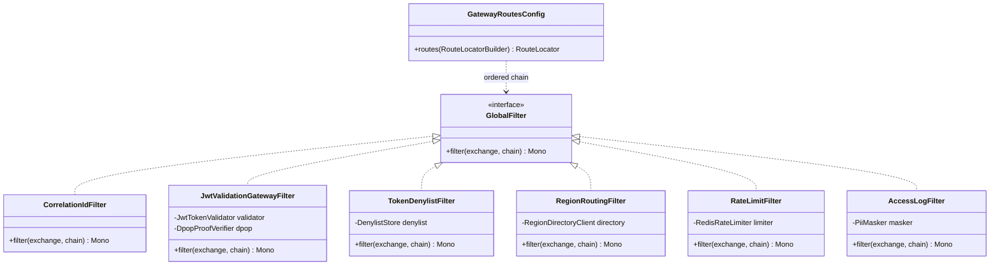

### 11.3 Identity & Access

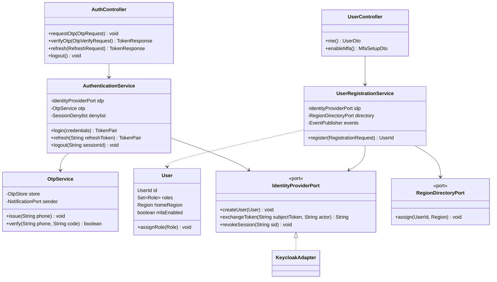

### 11.4 Patient Profile

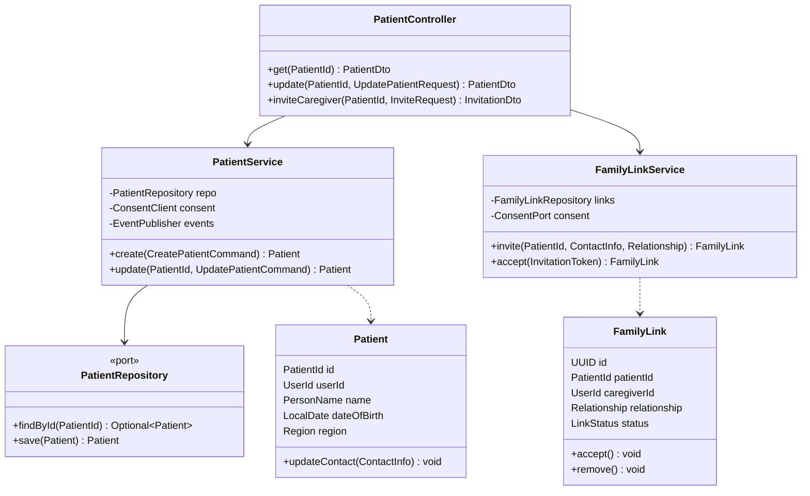

### 11.5 Consent & Access

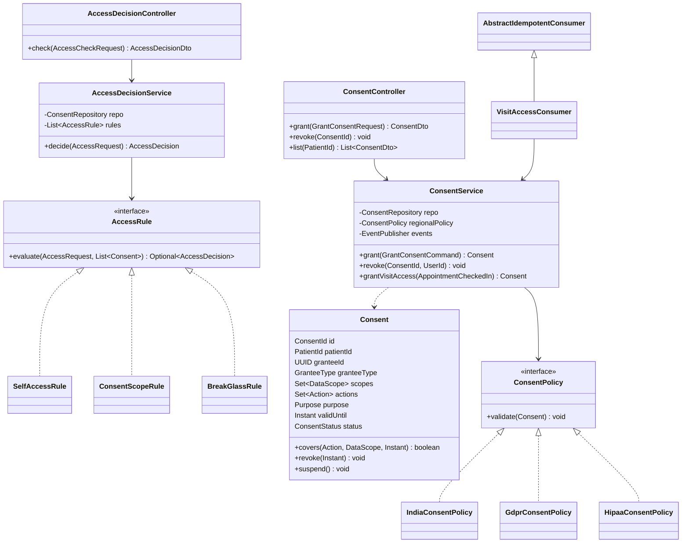

`AccessDecisionService` evaluates rules as a Chain of Responsibility; the first rule that decides wins and the default is deny. `BreakGlassRule` allows emergency clinical access with mandatory reason, immediate patient notification and audit.

### 11.6 Medical Records

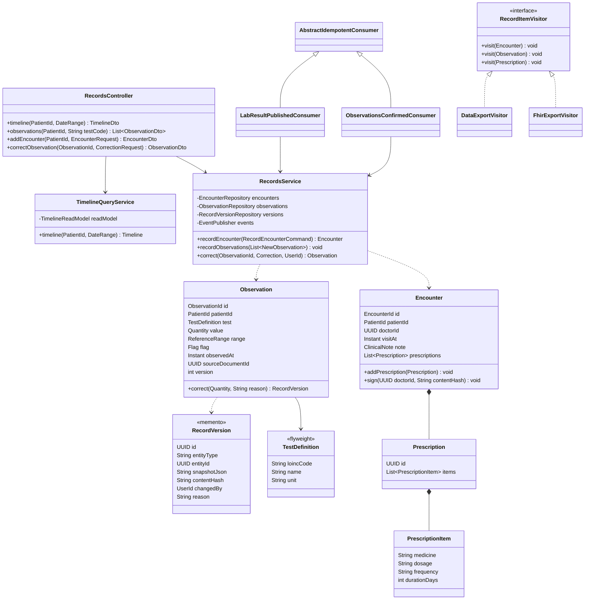

### 11.7 Document and Document Intelligence

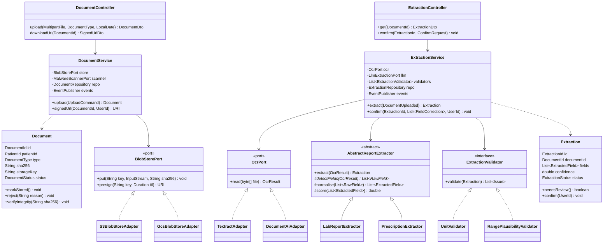

### 11.8 Provider Directory

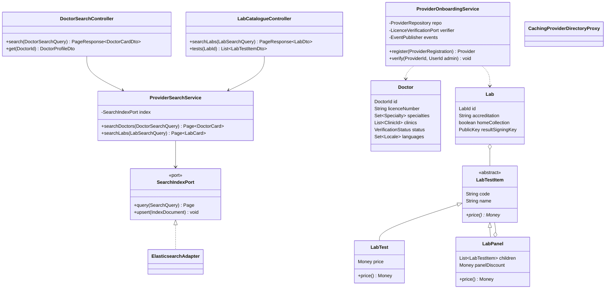

`LabPanel` is a Composite: a panel's price is the sum of its children minus the panel discount. `CachingProviderDirectoryProxy` is the client-side caching proxy other services use.

### 11.9 Scheduling

```mermaid
classDiagram
    class AvailabilityController {
        +setTemplate(DoctorId, AvailabilityTemplateRequest) void
        +slots(DoctorId, DateRange) List~SlotDto~
    }
    class AppointmentController {
        +book(BookAppointmentRequest) AppointmentDto
        +reschedule(AppointmentId, SlotId) AppointmentDto
        +cancel(AppointmentId, CancelRequest) void
        +checkIn(AppointmentId) void
        +complete(AppointmentId) void
    }
    class AvailabilityService {
        -AvailabilityTemplateRepository templates
        -SlotRepository slots
        -SlotGenerationStrategy strategy
        +publishWeek(DoctorId, LocalDate) List~Slot~
    }
    class AvailabilityTemplate {
        <<prototype>>
        DoctorId doctorId
        List~WeeklyWindow~ windows
        int slotMinutes
        ZoneId zone
        +copyForWeek(LocalDate) AvailabilityTemplate
    }
    class SlotGenerationStrategy {
        <<interface>>
        +generate(AvailabilityTemplate, DateRange) List~Slot~
    }
    class FixedIntervalStrategy
    class BufferedIntervalStrategy
    class BookingService {
        -SlotRepository slots
        -AppointmentRepository appointments
        -PricingPort pricing
        -ConsentClient consent
        -EventPublisher events
        -ClockProvider clock
        +hold(BookAppointmentCommand) Appointment
        +confirm(AppointmentId, PaymentId) void
        +expireHold(AppointmentId) void
        +cancel(AppointmentId, CancelReason, UserId) void
        +checkIn(AppointmentId) void
    }
    class Slot {
        SlotId id
        DoctorId doctorId
        Instant startAt
        Instant endAt
        SlotStatus status
        UUID holdId
        Instant heldUntil
        long version
    }
    class Appointment {
        AppointmentId id
        SlotId slotId
        PatientId patientId
        UserId bookedBy
        Money priceSnapshot
        AppointmentState state
        long version
        +confirm(PaymentId) void
        +checkIn(Clock) void
        +startConsultation() void
        +complete() void
        +cancel(CancelReason) void
        +markNoShow() void
    }
    class AppointmentState {
        <<interface>>
        +confirm(Appointment) AppointmentState
        +checkIn(Appointment) AppointmentState
        +cancel(Appointment) AppointmentState
    }
    class PendingPaymentState
    class ConfirmedState
    class CheckedInState
    class CompletedState
    class CancelledState
    class SlotRepository {
        <<port>>
        +tryHold(SlotId, UUID holdId, Instant until) boolean
        +markBooked(SlotId, UUID holdId) void
        +release(SlotId, UUID holdId) void
    }
    class JpaSlotRepository
    class HoldExpiryJob {
        +expireStaleHolds() void
    }
    class NoShowJob {
        +markNoShows() void
    }
    class PaymentSucceededConsumer
    AvailabilityController --> AvailabilityService
    AvailabilityService --> SlotGenerationStrategy
    AvailabilityService ..> AvailabilityTemplate
    SlotGenerationStrategy <|.. FixedIntervalStrategy
    SlotGenerationStrategy <|.. BufferedIntervalStrategy
    AppointmentController --> BookingService
    BookingService --> SlotRepository
    SlotRepository <|.. JpaSlotRepository
    BookingService ..> Appointment
    BookingService ..> Slot
    Appointment --> AppointmentState
    AppointmentState <|.. PendingPaymentState
    AppointmentState <|.. ConfirmedState
    AppointmentState <|.. CheckedInState
    AppointmentState <|.. CompletedState
    AppointmentState <|.. CancelledState
    HoldExpiryJob --> BookingService
    NoShowJob --> BookingService
    AbstractIdempotentConsumer <|-- PaymentSucceededConsumer
    PaymentSucceededConsumer --> BookingService
```

### 11.10 Lab Order

```mermaid
classDiagram
    class LabOrderController {
        +book(BookLabOrderRequest) LabOrderDto
        +cancel(LabOrderId) void
    }
    class LabStaffController {
        +assignCollection(LabOrderId, CollectionSlot) void
        +markCollected(LabOrderId, SampleInfo) void
        +rejectSample(LabOrderId, String reason) void
        +publishResults(LabOrderId, SignedResultPayload) void
    }
    class LabOrderService {
        -LabOrderRepository repo
        -LabCatalogueClient catalogue
        -EventPublisher events
        +book(BookLabOrderCommand) LabOrder
        +markCollected(LabOrderId, SampleInfo) void
        +rejectSample(LabOrderId, String) void
    }
    class ResultPublishingService {
        -ResultSignatureVerifier verifier
        -LabOrderRepository repo
        -EventPublisher events
        +publish(LabOrderId, SignedResultPayload) void
        +amend(LabOrderId, SignedResultPayload, String reason) void
    }
    class ResultSignatureVerifier {
        +verify(SignedResultPayload, PublicKey) ResultPayload
    }
    class LabOrder {
        LabOrderId id
        PatientId patientId
        LabId labId
        List~LabOrderItem~ items
        CollectionType collectionType
        Instant collectionAt
        Money priceSnapshot
        LabOrderState state
        long version
        +markPaid(PaymentId) void
        +scheduleCollection(Instant) void
        +collect(SampleInfo) void
        +rejectSample(String) void
        +publishResults(List~ResultLine~) void
    }
    class LabOrderItem {
        String testCode
        Money price
    }
    class LabOrderState {
        <<interface>>
    }
    LabOrderController --> LabOrderService
    LabStaffController --> LabOrderService
    LabStaffController --> ResultPublishingService
    ResultPublishingService --> ResultSignatureVerifier
    LabOrderService ..> LabOrder
    LabOrder *-- LabOrderItem
    LabOrder --> LabOrderState
```

### 11.11 Payment and Refund

```mermaid
classDiagram
    class PaymentController {
        +create(CreatePaymentRequest) PaymentDto
        +get(PaymentId) PaymentDto
    }
    class WebhookController {
        +receive(ProviderType, String rawBody, Map headers) ResponseEntity
    }
    class PaymentService {
        -PaymentRepository repo
        -PaymentProcessorFactory factory
        -RegionalComplianceFactory compliance
        -LedgerService ledger
        -EventPublisher events
        +createPayment(CreatePaymentCommand) Payment
        +applyProviderEvent(VerifiedWebhookEvent) void
        +syncStatus(PaymentId) void
    }
    class WebhookService {
        -WebhookVerifierRegistry verifiers
        -ProcessedWebhookRepository processed
        -PaymentService payments
        -RefundService refunds
        +handle(ProviderType, String body, Map headers) void
    }
    class Payment {
        PaymentId id
        BookingRef booking
        Money amount
        long capturedMinor
        long refundedMinor
        ProviderType provider
        String providerPaymentId
        PaymentState state
        long version
        +markPending(String providerId) void
        +authorize() void
        +capture(long amountMinor) void
        +fail(String reason) void
        +expire() void
        +reserveRefund(long amountMinor) void
        +refundableMinor() long
    }
    class PaymentState {
        <<interface>>
    }
    class PaymentProcessor {
        <<interface>>
        +createIntent(PaymentIntentRequest) PaymentIntentResult
        +fetchStatus(ProviderPaymentRef) ProviderPaymentStatus
    }
    class RefundProcessor {
        <<interface>>
        +refund(RefundRequest) RefundResult
        +fetchRefundStatus(ProviderRefundRef) ProviderRefundStatus
    }
    class WebhookVerifier {
        <<interface>>
        +verify(String body, Map headers) VerifiedWebhookEvent
    }
    class RazorpayAdapter
    class StripeAdapter
    class AdyenAdapter
    class ResilientPaymentProcessor {
        <<decorator>>
        -PaymentProcessor delegate
        -CircuitBreaker breaker
        -Retry retry
    }
    class PaymentProcessorFactory {
        +forContext(Region, PaymentMethod) PaymentProcessor
        +refundsFor(ProviderType) RefundProcessor
    }
    class RegionalComplianceFactory {
        <<abstract factory>>
        +forRegion(Region) RegionalComponents
    }
    class RegionalComponents {
        TaxCalculator tax
        ConsentPolicy consent
        DataRetentionPolicy retention
        PaymentRoutingConfig routing
    }
    class TaxCalculator {
        <<interface>>
        +taxFor(Money, ServiceType, Locale) Money
    }
    class GstCalculator
    class VatCalculator
    class UsSalesTaxCalculator
    class RefundService {
        -RefundRepository refunds
        -PaymentRepository payments
        -RefundPolicyResolver policies
        -PaymentProcessorFactory factory
        -LedgerService ledger
        -EventPublisher events
        +requestRefund(RefundCommand) Refund
        +submit(RefundId) void
        +applyProviderEvent(VerifiedWebhookEvent) void
        +retryDue() void
    }
    class Refund {
        RefundId id
        PaymentId paymentId
        String reasonRef
        long amountMinor
        RefundState state
        int attempts
        long version
        +submit() void
        +succeed(String providerRefundId) void
        +fail(String reason, Instant nextRetry) void
        +escalate() void
    }
    class RefundPolicyResolver {
        +resolve(RefundReason) RefundPolicy
    }
    class RefundPolicy {
        <<interface>>
        +amountFor(Payment, CancellationContext) long
    }
    class ProviderCancelledPolicy
    class TieredCancellationPolicy
    class NoShowPolicy
    class SystemErrorPolicy
    class LedgerService {
        -LedgerRepository repo
        +record(LedgerTransaction) void
    }
    class LedgerEntry {
        <<immutable>>
        UUID id
        String account
        long debitMinor
        long creditMinor
        String currency
        String prevHash
        String hash
    }
    class ReconciliationJob {
        -PaymentProcessorFactory factory
        -SettlementReportPort settlements
        +syncPending() void
        +reconcileDaily(LocalDate) ReconciliationReport
    }
    class BookingSagaOrchestrator {
        <<mediator>>
        -SagaRepository sagas
        +start(AppointmentHeld) void
        +onPaymentSucceeded(PaymentSucceeded) void
        +onPaymentFailed(PaymentFailed) void
        +onConfirmRejected(ConfirmRejected) void
    }
    PaymentController --> PaymentService
    WebhookController --> WebhookService
    WebhookService --> WebhookVerifier
    WebhookService --> PaymentService
    WebhookService --> RefundService
    PaymentService --> PaymentProcessorFactory
    PaymentService --> RegionalComplianceFactory
    PaymentService --> LedgerService
    PaymentService ..> Payment
    Payment --> PaymentState
    PaymentProcessorFactory ..> ResilientPaymentProcessor
    PaymentProcessor <|.. ResilientPaymentProcessor
    ResilientPaymentProcessor o-- PaymentProcessor
    PaymentProcessor <|.. RazorpayAdapter
    PaymentProcessor <|.. StripeAdapter
    PaymentProcessor <|.. AdyenAdapter
    RefundProcessor <|.. RazorpayAdapter
    RefundProcessor <|.. StripeAdapter
    RefundProcessor <|.. AdyenAdapter
    WebhookVerifier <|.. RazorpayAdapter
    WebhookVerifier <|.. StripeAdapter
    WebhookVerifier <|.. AdyenAdapter
    RegionalComplianceFactory ..> RegionalComponents
    RegionalComponents --> TaxCalculator
    TaxCalculator <|.. GstCalculator
    TaxCalculator <|.. VatCalculator
    TaxCalculator <|.. UsSalesTaxCalculator
    RefundService --> RefundPolicyResolver
    RefundPolicyResolver ..> RefundPolicy
    RefundPolicy <|.. ProviderCancelledPolicy
    RefundPolicy <|.. TieredCancellationPolicy
    RefundPolicy <|.. NoShowPolicy
    RefundPolicy <|.. SystemErrorPolicy
    RefundService ..> Refund
    RefundService --> LedgerService
    LedgerService ..> LedgerEntry
    ReconciliationJob --> PaymentProcessorFactory
    BookingSagaOrchestrator ..> PaymentService
```

`BookingSagaOrchestrator` is deployed with the Payment service and talks to Scheduling only through commands and events.

### 11.12 Notification

```mermaid
classDiagram
    class NotificationService {
        -PreferenceRepository prefs
        -NotificationChannelFactory channels
        -TemplateRenderer renderer
        +send(Message, Recipient) void
    }
    class Message {
        <<abstract>>
        #Channel channel
        +templateKey()* String
        +model()* Map
        +deliver(Recipient) void
    }
    class AppointmentReminderMessage
    class ResultReadyMessage
    class PaymentReceiptMessage
    class InsightAlertMessage
    class Channel {
        <<interface>>
        +send(Recipient, RenderedContent) DeliveryResult
    }
    class SmsChannel
    class EmailChannel
    class WhatsAppChannel
    class PushChannel
    class NotificationChannelFactory {
        +forPreference(ChannelPreference, Region) Channel
    }
    class TemplateRenderer {
        +render(String key, Locale, Map) RenderedContent
    }
    class DomainEventNotificationConsumer
    NotificationService --> NotificationChannelFactory
    NotificationService --> TemplateRenderer
    Message --> Channel : bridge
    Message <|-- AppointmentReminderMessage
    Message <|-- ResultReadyMessage
    Message <|-- PaymentReceiptMessage
    Message <|-- InsightAlertMessage
    Channel <|.. SmsChannel
    Channel <|.. EmailChannel
    Channel <|.. WhatsAppChannel
    Channel <|.. PushChannel
    AbstractIdempotentConsumer <|-- DomainEventNotificationConsumer
    DomainEventNotificationConsumer --> NotificationService
```

### 11.13 AI Insights

```mermaid
classDiagram
    class InsightsController {
        +latest(PatientId) List~InsightDto~
        +progressReport(PatientId, Period) ProgressReportDto
    }
    class InsightGenerationService {
        -RecordsClient records
        -TrendStrategyRegistry trends
        -CriticalValueRules critical
        -SpecialtyRuleTable specialties
        -SummaryWriter writer
        -GuardrailChain guardrails
        -InsightRepository repo
        -EventPublisher events
        +generate(PatientId, Trigger) List~Insight~
    }
    class TrendStrategy {
        <<interface>>
        +supports(String testCode) boolean
        +analyse(List~ObservationPoint~) TrendResult
    }
    class LinearTrendStrategy
    class ThresholdCrossingStrategy
    class CriticalValueRules {
        +check(ObservationPoint) Optional~CriticalAlert~
    }
    class SpecialtyRuleTable {
        +suggest(List~TrendResult~) Optional~Specialty~
    }
    class SummaryWriter {
        -LlmPort llm
        -PromptBuilder prompts
        +write(InsightFacts) DraftSummary
    }
    class PromptBuilder {
        <<builder>>
        +withFacts(InsightFacts) PromptBuilder
        +withLocale(Locale) PromptBuilder
        +withPolicy(PromptPolicy) PromptBuilder
        +build() Prompt
    }
    class Insight {
        InsightId id
        PatientId patientId
        InsightType type
        Severity severity
        String summary
        Specialty suggestedSpecialty
        List~UUID~ evidenceIds
        String modelVersion
        String promptVersion
        InsightState state
    }
    class ProgressReport {
        <<builder>>
        Period period
        List~ChartSeries~ charts
        String summary
    }
    class PdfReportVisitor
    class ObservationRecordedConsumer
    InsightsController --> InsightGenerationService
    InsightGenerationService --> TrendStrategy
    TrendStrategy <|.. LinearTrendStrategy
    TrendStrategy <|.. ThresholdCrossingStrategy
    InsightGenerationService --> CriticalValueRules
    InsightGenerationService --> SpecialtyRuleTable
    InsightGenerationService --> SummaryWriter
    SummaryWriter --> PromptBuilder
    InsightGenerationService ..> Insight
    InsightGenerationService ..> ProgressReport
    ProgressReport ..> PdfReportVisitor
    AbstractIdempotentConsumer <|-- ObservationRecordedConsumer
    ObservationRecordedConsumer --> InsightGenerationService
```

### 11.14 AI Assistant

```mermaid
classDiagram
    class AssistantController {
        +chat(ChatRequest) Flux~ChatEvent~
        +confirm(PendingActionId) ChatEvent
    }
    class AgentOrchestrator {
        -LlmPort llm
        -ToolRegistry tools
        -GuardrailChain guardrails
        -ConversationRepository conversations
        -PendingActionStore pending
        +handle(ChatRequest, AuthenticatedPrincipal) Flux~ChatEvent~
        +confirm(PendingActionId, AuthenticatedPrincipal) ChatEvent
    }
    class ToolRegistry {
        +definitions(Set~Role~) List~ToolDefinition~
        +resolve(String name) AgentTool
    }
    class AgentTool {
        <<interface>>
        +name() String
        +schema() JsonSchema
        +toCommand(JsonNode args, AuthenticatedPrincipal) AgentCommand
    }
    class AgentCommand {
        <<interface>>
        +requiresConfirmation() boolean
        +execute(OnBehalfOfToken) ToolResult
        +describe() String
    }
    class SearchDoctorsCommand
    class GetSlotsCommand
    class GetTrendCommand
    class BookAppointmentCommand
    class BookLabTestCommand
    class CancelBookingCommand
    class BookingFacade {
        <<facade>>
        -ProviderDirectoryClient directory
        -SchedulingClient scheduling
        +findOptions(Specialty, Location, DateRange) List~SlotOption~
        +book(SlotId, PatientId, String idempotencyKey) BookingResult
    }
    class GuardrailChain {
        -List~Guardrail~ links
        +check(GuardrailContext) GuardrailResult
    }
    class Guardrail {
        <<interface>>
        +apply(GuardrailContext) GuardrailResult
    }
    class PiiMaskingGuardrail
    class PromptInjectionGuardrail
    class NoDiagnosisGuardrail
    class CitationGuardrail
    class OnBehalfOfTokenProvider {
        +exchange(AuthenticatedPrincipal) OnBehalfOfToken
    }
    class LlmPort {
        <<port>>
        +stream(Prompt, List~ToolDefinition~) Flux~LlmEvent~
    }
    class RegionalLlmAdapter
    AssistantController --> AgentOrchestrator
    AgentOrchestrator --> LlmPort
    LlmPort <|.. RegionalLlmAdapter
    AgentOrchestrator --> ToolRegistry
    AgentOrchestrator --> GuardrailChain
    AgentOrchestrator --> OnBehalfOfTokenProvider
    ToolRegistry --> AgentTool
    AgentTool ..> AgentCommand
    AgentCommand <|.. SearchDoctorsCommand
    AgentCommand <|.. GetSlotsCommand
    AgentCommand <|.. GetTrendCommand
    AgentCommand <|.. BookAppointmentCommand
    AgentCommand <|.. BookLabTestCommand
    AgentCommand <|.. CancelBookingCommand
    BookAppointmentCommand --> BookingFacade
    SearchDoctorsCommand --> BookingFacade
    GuardrailChain o-- Guardrail
    Guardrail <|.. PiiMaskingGuardrail
    Guardrail <|.. PromptInjectionGuardrail
    Guardrail <|.. NoDiagnosisGuardrail
    Guardrail <|.. CitationGuardrail
```

Write commands (`BookAppointmentCommand`, `BookLabTestCommand`, `CancelBookingCommand`) return `requiresConfirmation() = true`; the orchestrator stores them as pending actions and executes only after the user confirms. Each carries an idempotency key, so a repeated confirmation cannot book twice.

### 11.15 Audit

```mermaid
classDiagram
    class AuditQueryController {
        +forPatient(PatientId, DateRange) PageResponse~AuditEntryDto~
        +verifyChain(DateRange) ChainVerificationDto
    }
    class AuditIngestService {
        -AuditRepository repo
        -HashChainer chainer
        +append(AuditEvent) AuditEntry
    }
    class HashChainer {
        +next(String prevHash, AuditEvent) String
    }
    class ChainAnchorJob {
        -WormStoragePort worm
        +anchorHead() void
    }
    class ChainVerifier {
        +verify(DateRange) ChainVerificationResult
    }
    class AuditEntry {
        <<immutable>>
        long sequence
        Instant at
        UUID actorId
        String actingAgent
        UUID patientId
        String action
        String resource
        String purpose
        String prevHash
        String hash
    }
    class AllEventsAuditConsumer
    AuditQueryController --> ChainVerifier
    AuditIngestService --> HashChainer
    AuditIngestService ..> AuditEntry
    ChainAnchorJob ..> AuditEntry
    AbstractIdempotentConsumer <|-- AllEventsAuditConsumer
    AllEventsAuditConsumer --> AuditIngestService
```

## 12. Lifecycle diagrams

Five entities carry state across services: appointments, lab orders, uploaded reports, consents and AI insights. Each state change is a domain event on Kafka; the end-to-end patient journey ties them together.

### 12.1 Patient care journey (end to end)

```mermaid
flowchart LR
    A[Register and create profile] --> B[Link family caregivers with consent]
    B --> C[Upload past reports and prescriptions]
    C --> D[OCR extraction and patient confirms values]
    D --> E[AI insights: trends, flags, suggested specialist]
    E --> F{Action needed?}
    F -- Doctor visit --> G[Book doctor slot]
    F -- Tests due --> H[Book lab test]
    F -- All stable --> M[Periodic progress report]
    H --> I[Lab publishes results into record]
    I --> E
    G --> J[Check-in: doctor sees history and summary]
    J --> K[Doctor notes and e-prescription saved]
    K --> L[Follow-up reminder]
    L --> E
    M --> E
```

### 12.2 Appointment lifecycle

```mermaid
stateDiagram-v2
    [*] --> SLOT_HELD : patient / caregiver / AI selects slot
    SLOT_HELD --> PENDING_PAYMENT : payment intent created
    SLOT_HELD --> EXPIRED : hold TTL elapsed
    PENDING_PAYMENT --> CONFIRMED : payment.succeeded
    PENDING_PAYMENT --> EXPIRED : payment failed or timed out
    CONFIRMED --> RESCHEDULED : user moves to new slot
    RESCHEDULED --> CONFIRMED
    CONFIRMED --> CANCELLED : user or doctor cancels (refund policy)
    CONFIRMED --> CHECKED_IN : patient arrives
    CONFIRMED --> NO_SHOW : grace period passed
    CHECKED_IN --> IN_CONSULTATION : doctor starts visit
    IN_CONSULTATION --> COMPLETED : notes and prescription saved
    COMPLETED --> [*]
    CANCELLED --> [*]
    EXPIRED --> [*]
    NO_SHOW --> [*]
```

### 12.3 Lab order lifecycle

```mermaid
stateDiagram-v2
    [*] --> BOOKED
    BOOKED --> PAID : payment.succeeded
    BOOKED --> CANCELLED
    PAID --> COLLECTION_SCHEDULED : phlebotomist / walk-in slot assigned
    COLLECTION_SCHEDULED --> SAMPLE_COLLECTED
    COLLECTION_SCHEDULED --> CANCELLED : refund
    SAMPLE_COLLECTED --> PROCESSING : sample received at lab
    SAMPLE_COLLECTED --> RECOLLECTION_NEEDED : sample rejected
    RECOLLECTION_NEEDED --> COLLECTION_SCHEDULED
    PROCESSING --> RESULTS_PUBLISHED : lab_result.published
    RESULTS_PUBLISHED --> AMENDED : lab corrects a result
    AMENDED --> RESULTS_PUBLISHED
    RESULTS_PUBLISHED --> [*]
    CANCELLED --> [*]
```

### 12.4 Uploaded report / document lifecycle

```mermaid
stateDiagram-v2
    [*] --> UPLOADED
    UPLOADED --> SCANNING : antivirus check
    SCANNING --> REJECTED : malware or unreadable file
    SCANNING --> STORED : encrypted in object storage
    STORED --> EXTRACTING : OCR + LLM extraction
    EXTRACTING --> NEEDS_REVIEW : low confidence or missing fields
    EXTRACTING --> PENDING_CONFIRMATION : values ready
    NEEDS_REVIEW --> PENDING_CONFIRMATION : user corrects values
    PENDING_CONFIRMATION --> CONFIRMED : user confirms
    CONFIRMED --> INDEXED : observations written to record
    INDEXED --> ANALYSED : AI insight generated
    ANALYSED --> ARCHIVED : retention policy
    INDEXED --> DELETED : patient erasure request
    REJECTED --> [*]
    ARCHIVED --> [*]
    DELETED --> [*]
```

### 12.5 Consent lifecycle (caregiver, doctor, lab)

```mermaid
stateDiagram-v2
    [*] --> REQUESTED : caregiver invites self, or patient invites caregiver
    REQUESTED --> ACTIVE : patient approves scopes and expiry
    REQUESTED --> DENIED
    [*] --> ACTIVE : auto-grant to doctor at check-in (visit window)
    ACTIVE --> SUSPENDED : patient pauses access
    SUSPENDED --> ACTIVE
    ACTIVE --> REVOKED : patient revokes
    ACTIVE --> EXPIRED : valid_until reached
    DENIED --> [*]
    REVOKED --> [*]
    EXPIRED --> [*]
```

### 12.6 AI insight lifecycle

```mermaid
stateDiagram-v2
    [*] --> TRIGGERED : new observation / visit / schedule
    TRIGGERED --> COMPUTING : load history, compute trends
    COMPUTING --> CRITICAL_ALERT : value beyond critical threshold (rule-based)
    COMPUTING --> DRAFTED : LLM summary with evidence links
    DRAFTED --> BLOCKED : guardrail check fails
    BLOCKED --> DRAFTED : regenerate with stricter prompt
    DRAFTED --> PUBLISHED : guardrail check passes
    CRITICAL_ALERT --> PUBLISHED
    PUBLISHED --> ACKNOWLEDGED : patient / caregiver views it
    ACKNOWLEDGED --> ACTIONED : appointment or lab test booked
    PUBLISHED --> SUPERSEDED : newer insight for same test
    ACKNOWLEDGED --> SUPERSEDED
    ACTIONED --> [*]
    SUPERSEDED --> [*]
```

## 13. AI agent design

Two agents share one tool layer: a background Insights agent driven by events, and a conversational Assistant driven by the user. Neither calls databases directly; both act only through platform APIs, under the requesting user's identity and consent.

### 13.1 Insights agent (background)

Triggered by `observation.recorded`, `appointment.booked`, and a monthly scheduler.

1. Load the patient's observations for each test (e.g. HbA1c, LDL, creatinine, TSH, haemoglobin) over the selected window.
2. Compute trends deterministically in Java: latest vs previous, slope, % change, out-of-range flags against the lab's reference range. The LLM never does the arithmetic.
3. Pass the computed facts plus visit notes to the LLM to write a plain-language summary: improved, worsened, stable, missing follow-ups.
4. Map abnormal patterns to a specialty using a curated rule table (e.g. rising creatinine → nephrologist; HbA1c above range → endocrinologist / diabetologist), with the LLM only explaining the suggestion.
5. Store an `Insight` with its evidence (observation ids), model version and prompt version; publish `insight.generated`, or `alert.raised` for critical values.
6. Generate a progress report (charts + summary, PDF export) on demand or every 6 months.

### 13.2 Assistant agent (conversational)

A tool-calling agent (Spring AI or LangGraph, MCP-style tools) exposed at `/assistant/chat` with streaming responses.

| Tool | Backed by | Needs user confirmation |
| --- | --- | --- |
| `get_health_timeline(patientId, from, to)` | Medical Records | No |
| `get_test_trend(patientId, testCode)` | Medical Records / AI Insights | No |
| `get_latest_insights(patientId)` | AI Insights | No |
| `search_doctors(specialty, city, date, language)` | Provider Directory | No |
| `get_doctor_slots(doctorId, dateRange)` | Scheduling | No |
| `book_appointment(patientId, slotId)` | Scheduling + Payment | **Yes** |
| `search_labs(testCodes, city, homeCollection)` | Provider Directory | No |
| `book_lab_test(patientId, labId, tests, slot)` | Lab Order + Payment | **Yes** |
| `cancel_or_reschedule(bookingId)` | Scheduling / Lab Order | **Yes** |
| `generate_progress_report(patientId, period)` | AI Insights | No |

A caregiver asking "book Papa's next diabetes follow-up" resolves to: check consent (book-on-behalf scope) → `get_latest_insights` → `search_doctors(endocrinology)` → `get_doctor_slots` → propose 2–3 options → user confirms → `book_appointment`.

### 13.3 Guardrails

- **No diagnosis or prescribing.** Output is framed as observations and "discuss with a doctor"; a system prompt plus an output classifier block dosage and diagnosis statements.
- **Critical values bypass the LLM.** Rule-based thresholds raise alerts directly with an advice to seek care urgently.
- **Grounding.** Every statement cites the observation or document it came from; the UI links to the source report.
- **Consent-scoped tools.** Each tool call carries the end user's token; the Consent service decides, not the agent.
- **Human-in-the-loop** for any write action (bookings, cancellations) and for low-confidence OCR extractions.
- **PII minimisation.** Names and identifiers are replaced with tokens before prompts leave the platform; LLM provider chosen with India data-residency and no-training terms.
- **Evaluation.** Golden test sets for extraction accuracy and summary faithfulness, run in CI on each prompt or model change.

## 14. Compliance and non-functional requirements

Health data is sensitive personal data, so privacy controls are part of the core design, not an add-on. Targets below are proposed starting points to confirm with the client.

### Security and compliance

- **Regulation:** India's Digital Personal Data Protection Act 2023 (consent, purpose limitation, erasure, breach reporting); clinical record norms; ABDM health-data guidelines when integrated.
- **Authentication:** OAuth 2.0 / OIDC via Keycloak; OTP login for patients; MFA mandatory for doctors, lab staff and admins.
- **Authorisation:** RBAC for roles plus consent-based ABAC (who, whose data, which record types, purpose, expiry) evaluated by the Consent service.
- **Encryption:** TLS 1.2+ in transit, mTLS between services; AES-256 at rest; documents encrypted with per-tenant keys in a KMS.
- **Audit:** every access to health data logged with actor, patient, purpose and timestamp; patients can see who viewed their records.
- **Data residency:** all patient data stored in India regions.
- **Application security:** OWASP ASVS checks, SAST/DAST in CI, dependency scanning, virus scan on every upload, presigned URLs that expire in minutes.

### Non-functional targets

| Area | Proposed target |
| --- | --- |
| Availability | 99.9% for booking and records APIs |
| Latency | p95 under 300 ms for read APIs; slot booking under 1 s end to end |
| OCR + extraction | Result ready for review within 2 minutes of upload |
| Insight generation | Within 5 minutes of a new observation |
| Scale (initial) | 1M patients, 20k doctors, 2k labs, 50k bookings a day |
| Backup and recovery | RPO 15 minutes, RTO 1 hour; point-in-time recovery for PostgreSQL |
| Retention | Records kept per clinical-record rules; erasure on request where law allows |
| Observability | OpenTelemetry traces, Prometheus metrics, centralised logs, SLO alerting |

### Consistency rules

- **No double booking:** atomic conditional slot hold in the database (section 10), then a DB unique constraint on `(slot_id)` for confirmed bookings; optimistic locking on the slot row.
- **Booking + payment:** saga with compensation (release slot, refund) instead of distributed transactions.
- **Event delivery:** transactional outbox + idempotent consumers; retry topics and a dead-letter topic.

## 15. Deployment, tech stack and rollout

Services run as containers on Kubernetes in an India cloud region across three availability zones, deployed through GitOps. The stack below is a recommendation; cloud provider is interchangeable (AWS or GCP equivalents).

### Tech stack

| Layer | Choice |
| --- | --- |
| Backend services | Java 21, Spring Boot 3, Spring Cloud Gateway, Spring Security, Spring Data JPA, Resilience4j |
| AI layer | Spring AI (or a Python LangGraph service), MCP-style tool definitions, pgvector for embeddings |
| OCR | Cloud document AI (AWS Textract / Google Document AI) with LLM post-processing |
| Messaging | Apache Kafka (managed: MSK / Confluent), Schema Registry with Avro |
| Databases | PostgreSQL per service, Redis, Elasticsearch / OpenSearch, append-only audit store |
| Files | S3 / GCS with KMS encryption |
| Identity | Keycloak (OIDC) |
| Frontend | React (web portal), React Native or Flutter (mobile) |
| Platform | Kubernetes (EKS / GKE), Helm, Argo CD, Istio or Linkerd for mTLS |
| CI/CD | GitLab CI: build, tests, SAST, image scan, deploy to dev → staging → prod |
| Observability | OpenTelemetry, Prometheus, Grafana, ELK / Loki |

### Environments

- **Dev** and **staging** with synthetic patient data only; no production data leaves production.
- **Production** multi-AZ; PostgreSQL with a read replica; Kafka with replication factor 3.
- **DR** warm standby in a second India region.

### Phased rollout

1. **Phase 1 — Records and family access (MVP):** identity, patient profile, consent, documents, OCR extraction, medical records timeline, trend charts, caregiver view.
2. **Phase 2 — Booking:** provider directory, doctor scheduling, lab orders, payments, notifications, doctor pre-visit summary.
3. **Phase 3 — AI:** insights agent, progress reports, assistant with booking tools.
4. **Phase 4 — Ecosystem:** ABDM / ABHA linking, teleconsultation, wearables, pharmacy.

### Production readiness

| Area | Practice |
| --- | --- |
| Unit and domain tests | Aggregates and state machines tested without Spring; mutation testing (PIT) on Payment, Scheduling, Consent |
| Integration tests | Testcontainers for PostgreSQL, Kafka, Redis; every repository and consumer tested against real infrastructure |
| Contract tests | Pact for REST between services; Avro compatibility checks for events; `PaymentProcessorContractTest` for every provider adapter |
| Concurrency tests | 1,000 parallel bookings for one slot must yield exactly one appointment and one capture; duplicate-webhook and crash-mid-saga tests |
| Performance | Gatling load tests in CI for booking and timeline APIs against the NFR targets |
| Resilience | Chaos tests (provider timeout, Kafka broker loss, pod kill during saga) in staging every release |
| Security | Threat model (STRIDE) per service, SAST/DAST, dependency and image scanning, annual penetration test, JWT attack test suite (alg none, key confusion, replay, expired, wrong audience) |
| Architecture fitness | ArchUnit rules for hexagonal layering and least knowledge; build fails on violation |
| Releases | Blue-green or canary via Argo Rollouts; database changes with Flyway, expand-and-contract only; feature flags for AI features |
| Operations | SLOs with error budgets, runbooks per alert, on-call rotation, quarterly DR drills, monthly reconciliation review with finance |
| AI quality | Golden datasets for OCR extraction and summary faithfulness; prompt and model versions pinned and tracked per insight |
| Documentation | OpenAPI per service, AsyncAPI for events, Architecture Decision Records for each choice in sections 3, 5, 8 and 10 |

### Open questions for the client

- Payment providers already contracted in each region, and whether the platform or each clinic is the merchant of record
- Cancellation and refund rules per clinic and lab type
- Legal sign-off on cross-region caregiver access (section 5.2)
- Existing hospital or lab systems to integrate (HIS, LIS) and their interfaces
- Target launch region and expected volumes for the first year